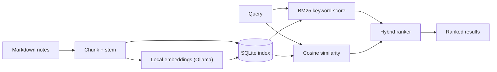

**Links:** [GitHub](https://www.github.com/anklus-dev/cosi)

## What it is

cosi (pronounced "cozy," from **co**sine **si**milarity) searches a folder of markdown notes without sending anything off your machine. It combines classical keyword retrieval with embedding-based semantic search. I built it as an extra credit project for CSC 2510, Theoretical Foundations for Computer Science, at Georgia State Perimeter.

## How it works

Notes are split into chunks and indexed once. At query time, two scores are computed and blended.

## What I built

- **Hybrid retrieval.** BM25 over stemmed tokens, plus cosine similarity over `nomic-embed-text` embeddings from a local Ollama server, combined into one ranking.
- **Graceful fallback.** If Ollama isn't running, cosi detects it at startup and drops to keyword-only mode instead of failing.
- **Sentence-aware chunking** and a web UI that shows each result's score breakdown.
- **Docker packaging** with a separate Linux configuration, because Ollama on Linux only listens on localhost and a normally-networked container can't reach it.
- **An evaluation harness.** 44 hand-labeled questions over the sample notes, comparing BM25 alone, cosine alone, and the blend, with a sweep over blend weights and significance testing.

## What the evaluation changed

My first blend weighted keywords 0.4 and meaning 0.6. The sweep showed that scored below meaning-only search, so I moved to 0.2 / 0.8, which came out slightly ahead (MRR 0.95 vs 0.94). The sample set is small, so I treat that as a reasonable default and not a proven result.

## What I learned / what's next

It's likely, outside very specific situations, unnecessary to combine keyword and semantic search like this. It's only better in certain situations, under certain parameters. The next steps for this project would be expanding its usable files (txt, pdf, etc.) and hooking it into pre-established local note-taking software (Logseq, Obsidian).

I'd also like to test weather fuzzy-style search is a better thing to mix with semantic search than keyword.